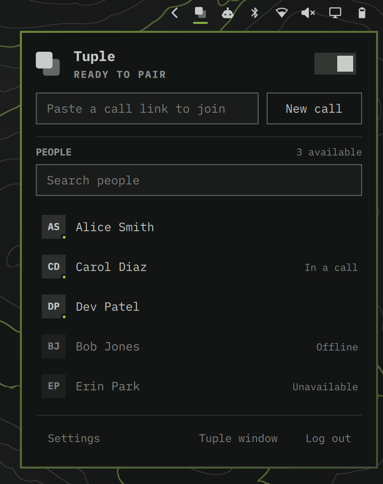
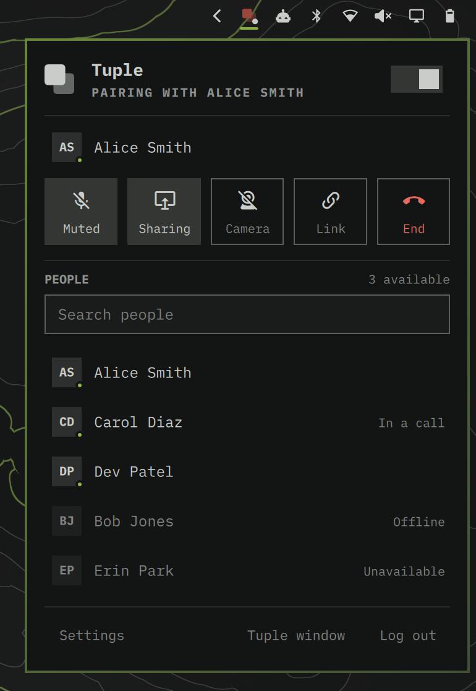
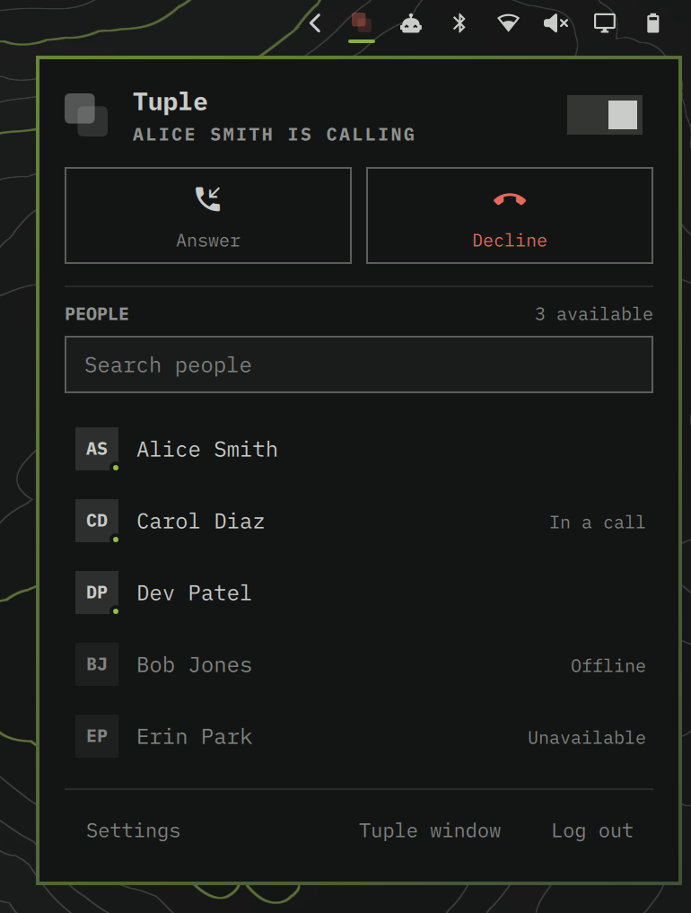
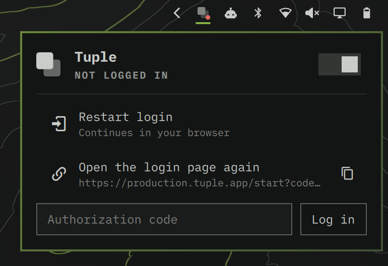

# Tuple for Omarchy

A native [Omarchy](https://omarchy.org) bar widget and panel for
[Tuple's Linux client](https://tuple.app/linux/) (alpha, v2026_09_16.1). Tuple
for Linux is a command-line tool; this gives it a home in your bar. It's built
with the same Quickshell UI kit as Omarchy's own Tailscale, Bluetooth and Audio
panels, so it picks up your theme, fonts, borders and keyboard conventions.

<table>
  <tr>
    <td></td>
    <td></td>
  </tr>
  <tr>
    <td align="center"><sub><b>Ready to pair.</b> One field starts or joins a call. Teammates are listed available-first, with presence shown once.</sub></td>
    <td align="center"><sub><b>In a call.</b> The controls show state (Muted, Sharing), and the bar icon turns the active colour.</sub></td>
  </tr>
  <tr>
    <td></td>
    <td></td>
  </tr>
  <tr>
    <td align="center"><sub><b>Incoming call.</b> The bar icon pulses and you get a desktop notification.</sub></td>
    <td align="center"><sub><b>Log in.</b> Login continues in your browser; paste the code back here.</sub></td>
  </tr>
</table>

<sub>Screenshots use the built-in demo data (`omarchy-shell sehl.tuple demo <state>`) on a dark Omarchy theme.</sub>

## What you get

- **Bar icon:** Tuple's mark drawn in theme colours. It is dimmed with a slash
  when Tuple is off, shows a red badge when you're logged out, turns the
  "active" colour during a call (darker when muted), gets a dot while you share
  your screen, and pulses on an incoming call.
- **Panel:**
  - an on/off switch for the daemon
  - browser login with an auth-code field
  - new call (copies your link)
  - join a call from a pasted link or straight from the clipboard
  - in-call controls: mute, share, camera, copy link, end
  - who's in the call and who's sharing
  - favourites and available teammates, with search across the whole org
    directory, a ★ toggle, and one-click calling
  - all `tuple settings`
  - a shortcut to Tuple's own window, and log out
- **Notifications:** you get a desktop notification for incoming calls.
- **Depth, if your theme asks for it.** Themes that ship a `[material]`
  section in `shell.toml` (Rams does) turn the call controls and buttons
  into keys: they stand on a short lip and sink when pressed, and mute,
  share and camera latch down while on. Join turns into an orange key
  once a link is pasted, and the panel casts a soft shadow. Other themes
  keep the flat look. The keys are documented in `Material.qml`;
  `KeyFace.qml` and `CardShadow.qml` can be copied into other plugins.

## Webcams

- **The camera stage.** Their webcam and your camera sit together as equal
  squares in the bottom-right corner, yours on the right and mirrored. They
  stay on every workspace and never take focus. `cameraSize`
  (`small`/`medium`/`large`) sets the tile size for both.
- **How it works.** Tuple draws all its windows over X11 with class `Tuple`
  and no title. Each window's `WM_CLASS` instance names its role, though
  (`tuple-webcams`, `tuple-screen`, `tuple-join-request`, …).
  `bin/tuple-windows` copies that role into the window title, then floats
  and centres Tuple's prompts and lays out the stage. The panel runs it
  whenever Tuple logs `map window:`/`unmap window:` or your camera turns on
  or off. `hypr/tuple.lua` makes Tuple's windows fully opaque, because
  Omarchy's default translucency doesn't belong on video.
- **Your camera can't reach them on its own.** In v2026_09_16.1, Tuple for
  Linux can't send webcam video: `WebcamCapturerAdapter: TODO: implement
  Start`, and it rejects `ShareWebcamRequest`. Your tile
  (`bin/tuple-selfcam`) is a local view that reaches them only through your
  screen share. The panel says so while the camera is on and you aren't
  sharing.
  - **Choosing a camera:** the Camera button is a split button. The main part
    turns your tile on or off, and the caret (or `Shift+V`) opens a menu:
    **System default** (the first camera, named in the menu), then each
    camera. A chosen camera is saved by name, since `/dev/videoN` numbers
    change between boots. If it isn't plugged in, the default is used.
  - The tile uses 720p, and MJPEG when the camera offers it, because raw 720p
    over USB is often capped at 10fps.

## Their screen

When they share, the panel shows a **Their screen** row:

- **View** brings Tuple's screen window forward.
- **Control** switches between drawing on their screen and driving it
  (Tuple's `guest-mode` setting: `annotation` or `control`).

When someone asks to join your call, you get a desktop notification, and
Tuple's prompt is centred and focused.

## Notifications Tuple doesn't post yet

Tuple's own toasts for these are stubs on Linux (`TODO: implement …` in the
log), so the panel posts them instead:

- **Join requests:** critical, with a **Show** button that focuses Tuple's
  prompt.
- **Someone joined:** a 4-second toast (`notifyJoins`).
- **Everyone left:** your link call stays open after the last person leaves.
  About 15s later you get "Everyone left" with an **End call** button.

## Reliability

- **No stuck buttons:** every `tuple` command has a time limit (20s for most,
  45s for `ls`/`settings`/`on`/`off`, 90s for login, 120s for `call`). A
  wedged daemon shows an error and frees the button.
- **No leaked helpers:** the log follower and the mic router exit together
  with their child processes (`tail --pid`, and a process substitution with
  an exit trap) instead of leaving them orphaned.
- **Ending is immediate:** a call counts as over as soon as Tuple logs
  `invalidating call`, without waiting for the grace period.
- **Less noise:** while someone shares, Tuple logs every move of their cursor
  (about 99% of a call's log). The follower drops those lines before they
  reach QML.
- **Log archive:** only new, complete lines are copied, with an offset kept
  per file. Tuple's auth token is redacted on the way.
- **Throttled refresh:** opening the panel refreshes at most every 15s.
  `r`, middle-click and IPC `refresh` always force a refresh.

## Performance notes

Tuple renders over X11, so every frame of their screen and webcam crosses into
XWayland. Video translucency is off for Tuple's windows. During calls,
`bin/tuple-perf` appends a sample every 20s to
`~/.local/state/omarchy-tuple/perf.log`: CPU for Tuple, XWayland, the shell
and your camera tile, plus the size of their screen and webcam windows. If
video stutters, that log shows where the time goes. Turn it off with
`perfLog`.

## Microphone

The Mic button is a split button too. The main part mutes and unmutes, and the
caret (or `Shift+M`) picks the input: **System default** (PipeWire's default
source, named in the menu) or a specific mic. Tuple for Linux has no input
setting and records from the default source, so a specific mic is applied by
moving Tuple's own recording stream to it (`bin/tuple-mic-route`, via
`pactl move-source-output`) for as long as the call lasts. The system default
isn't changed. Saved as `micDevice`; blank means system default.

## Requirements

- Omarchy with the Quickshell-based shell (`omarchy-shell`)
- The Tuple CLI from [tuple.app/linux](https://tuple.app/linux/) on your
  `PATH`; `~/.local/bin` and `~/bin` are checked too
- `socat`, `jq`, `hyprctl`, `wl-copy` and `notify-send`
- For the camera overlay: `mpv` and `v4l2-ctl`. For mic selection: `pactl`. Omarchy ships these.

## Install

```bash
git clone https://github.com/benjaminsehl/omarchy-tuple.git ~/Code/omarchy-tuple
cd ~/Code/omarchy-tuple
./install.sh            # symlinks into ~/.config/omarchy/plugins/sehl.tuple, adds it to the bar,
                        # and loads hypr/tuple.lua via ~/.local/state/omarchy/toggles/hypr/tuple.lua
./uninstall.sh          # undoes all three
```

Pass a placement to `install.sh`, e.g. `./install.sh --section right --before omarchy.agents`.

The shell's plugin watcher doesn't follow symlinks, and re-creating the link
(`./install.sh`) logs a reload but keeps serving the old, cached QML. After
editing, run `omarchy restart shell`.

## Use

| Bar | Action |
|---|---|
| left click | open the panel |
| right click | in a call: mute/unmute · ringing: answer |
| middle click | in a call: share/unshare · otherwise: refresh |

In the panel, `j`/`k` or the arrow keys move, and `enter`/`space` activates the
selected row. Other keys:

| Key | Action |
|---|---|
| `m` | mute |
| `s` | share |
| `v` | camera overlay |
| `e` | end or decline |
| `a` | answer |
| `n` | new call |
| `i` | join field |
| `c` | copy call link |
| `/` | search people |
| `f` | favourite the selected person |
| `o` | daemon on/off |
| `r` | refresh |
| `tab` | next panel |
| `esc` | close |

### IPC and keybindings

```bash
omarchy-shell sehl.tuple toggle | toggleMute | toggleShare | toggleCamera | end | newCall | joinClipboard | copyLink | on | off
omarchy-shell sehl.tuple join https://tuple.app/c/xyz
omarchy-shell sehl.tuple cameras       # list cameras; camera <name|number|default> picks one
omarchy-shell sehl.tuple mics          # list mics;    mic <name|number|default> picks one
omarchy-shell sehl.tuple deviceMenu mic   # open the panel with the mic (or camera) menu
omarchy-shell sehl.tuple status        # JSON: daemon, loggedIn, call, peers, muted, sharing, …
omarchy-shell sehl.tuple demo call     # canned UI states: call | idle | incoming | login | off (back to live)
```

Example Hyprland bindings (not installed for you), in `~/.config/hypr/bindings.lua`:

```lua
o.bind("SUPER + CTRL + T", "Tuple panel", "omarchy-shell sehl.tuple toggle")
o.bind("SUPER + CTRL + M", "Tuple mute", "omarchy-shell sehl.tuple toggleMute")
```

## How the Tuple Linux client works

These findings come from capturing traffic on the CLI's socket and from the
binary's strings. They are the basis of `Model.js`.

- **Thin CLI:** `tuple` is one static binary. Each invocation is a thin
  client: it connects to the **abstract unix socket `@tuple-daemon`**, sends
  its argv framed as `u64 len, u64 argc, "arg\0arg\0…"`, forwards stdin, and
  prints the plain text the daemon streams back until EOF.
- **Auto-start:** any command, even `tuple help`, spawns the daemon if none is
  listening. That's why the widget checks `/proc/net/unix` for
  `@tuple-daemon` and never runs a command while the daemon is off.
- **Truncated replies:** the daemon writes replies with non-blocking sends and
  drops the rest on `EAGAIN` (`write to deferred ls pipe failed, error=11`).
  The stock CLI drains too slowly, so `tuple ls` returns only ~71 of ~7,800
  people. `bin/tuple-request` speaks the socket protocol through `socat` and
  gets everything; the widget uses it for `ls` and `settings`.
- **No status API:** there is no status or JSON command. Live state comes from
  the daemon log at `~/.local/share/tuple/<n>/log.txt`, which is truncated on
  every start and formatted `time|pid|tid|level|[File.cpp:N|]message`. The
  widget tails it and folds in these messages:
  - `signaler state changed: A -> B`
  - `received incoming call: X`
  - `peer joined call: X` and `peer left call: X`
  - `call connected`
  - `EngineEvent: OnPeerAdded/OnPeerRemoved (peer <contact id> …)`, mapped to
    names from `ls`
  - `OnVideoCapturerDesktop Start/Stop` (your screen share)
  - `webcam: added feed` and `WebcamReceivingChange` (their webcam)
  - `cli: end`, then `call ended`, a remote hang-up, or the call's audio
    context (`ContextState: TERMINATED`)
  - **Log replays:** on a shell restart the log is replayed without the
    commands' replies, so `cli: end` resolves to idle once the log moves 3s
    past it.
- **Log archive:** the log is truncated whenever the daemon restarts. The
  widget keeps a rolling copy of the last 20 runs in
  `~/.local/state/omarchy-tuple/logs/`, which is what the parser is
  calibrated against.
- **Command output:**
  - `tuple ls` prints `  ID Name <email> [available|unavailable|in call|offline]( (favorite))`.
  - `tuple call` prints the online favourites as `  N) Name <email>` and reads
    the chosen number from stdin. The panel answers that prompt for the person
    you clicked.
  - `tuple new` prints `personal url: https://tuple.app/c/…`.
  - `tuple settings` prints `name | value | description (a|b)`.
- **Call links:** `join` only accepts `https://tuple.app/c/…` or
  `https://production.tuple.app/c/…` links.
- **Tuple's own window:** `tuple ui` opens an X11 window that only shows a few
  lines of status text. It's the only place to accept an incoming call, so the
  Answer button opens it.

## Known gaps (alpha client)

- **Mute state:** mute is never logged. The widget tracks it from its own
  `mute`/`unmute` replies, the `start-calls-muted` setting, and the call
  starting. If you mute from a terminal, the widget won't know.
- **Partly verified:** call state is calibrated against one real call (peers,
  screen share, their webcam, ending). Answering an incoming call, the camera
  stage with a real peer webcam, the Their screen row and mic routing haven't
  been seen live yet. `omarchy-shell sehl.tuple
  status` shows what the widget currently believes.
- **Calling restrictions:** `tuple call` only offers online favourites. The
  call button works for anyone who's online: for someone who isn't a
  favourite, it stars them first, and the tooltip says so. Clicking the row
  itself only rings favourites, so a stray click can't ring someone new.
- **Ringing:** `tuple call` adds the callee as a peer before they answer. The
  widget shows "Calling X…" until `call connected` (or the call's audio
  context) appears. If nobody answers in ~25s, the engine logs
  `OnPeerRemoved (… reason=timeout)`, and the widget tells you they didn't
  answer. A call that's answered has only been seen through call links. If a
  direct call doesn't connect, use **New call** and send the link.

## Develop

```bash
node --test tests/*.test.mjs   # Model.js parsers + log reducer
omarchy plugin validate .
```

Files:

- `Model.js`: pure parsing and the state reducer; no QML.
- `Service.qml`: the daemon probe, log follower, command runner and camera
  overlay.
- `Panel.qml`: the bar button and panel UI.
- `TupleIcon.qml`: the logo.
- `bin/tuple-request`: talks to the daemon socket directly, for complete
  replies and without starting the daemon.
- `bin/tuple-windows`: names Tuple's X11 windows, centres its prompts, and
  lays out the camera stage.
- `bin/tuple-selfcam`: your camera as a square, mirrored tile.
- `bin/tuple-mic-route`: keeps Tuple's recording stream on your chosen mic.
- `bin/tuple-perf`: one line of call performance for `perf.log`.
- `DeviceMenu.qml`: the Mic/Camera split-button menu.
- `hypr/tuple.lua`: Hyprland window rules.
- `docs/screenshots/`: screenshots for this README, captured with `demo` mode.

The panel follows a few design rules:

- The status line under the title says where you are, so sections don't
  repeat it.
- One control per intent.
- Presence is shown once.
- Secondary actions appear on the row you point at.
- Shortcuts live in tooltips, not on the controls.
